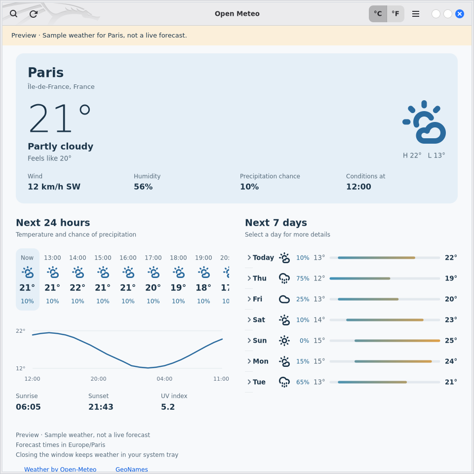

<p align="center">
  
</p>

<h1 align="center">Open Meteo</h1>

[](https://github.com/fossgap/open-meteo/actions/workflows/test-ci.yml)
[](https://github.com/fossgap/open-meteo/actions/workflows/release-ci.yml)
[](https://github.com/fossgap/open-meteo/releases)
[](https://github.com/fossgap/open-meteo/releases)
[](Cargo.toml)
[](Cargo.toml)
[](docs/packaging.md)

> A native Linux weather app: current conditions, the next 24 hours, and the week ahead, with quick access from your system tray.

A small, native weather app built with **Rust, GTK 4, and libadwaita**. Check the
weather, see what changes over the next day, and keep a forecast in your system
tray. No account or API key is needed for the public service's non-commercial use.

A [FOSSGap](https://github.com/fossgap) project and independent desktop client; not affiliated with the
[Open-Meteo weather service](https://open-meteo.com/).

[Features](#features) · [Installation](#installation) · [Usage](#usage) · [Building from source](#building-from-source) · [CI and releases](docs/ci-release.md)



## Features

- **Current conditions:** temperature, feels-like temperature, humidity, wind,
  and precipitation probability.
- **The next 24 hours:** a horizontally scrollable forecast and temperature chart.
- **The next seven days:** comparable temperature ranges and expandable daily
  details, including sunrise, sunset, and maximum wind.
- **Location search:** cities and postal codes, with the five most recent places
  remembered. Your location is never detected automatically.
- **Weather in the panel:** the weather condition icon with a temperature badge
  on StatusNotifier desktops, plus hourly and weekly forecasts, refresh, open,
  and quit actions. Both remain visible in the tray's square icon slot.
- **GNOME clock:** the bundled Open Meteo Clock extension places the weather icon
  and temperature beside the system clock, with forecast actions in its menu.
- **Offline support:** the last successful forecast for each location is saved.
  Saved data is labelled with its timestamp; expired hours and days are omitted.
- **Desktop integration:** follows the desktop's light/dark preference, adapts to
  narrow windows, and supports keyboard navigation.
- **Units:** switch between Celsius / km/h and Fahrenheit / mph instantly.
- **Languages:** English, French, German, Spanish, Simplified Chinese, Hindi, and
  Arabic, including right-to-left layout and localized dates and numbers.

Forecasts refresh every 15 minutes while the app is running. Network requests run
on background threads so the window remains usable.

## Installation

Linux x86_64 release builds produce Debian/Ubuntu (`.deb`), Fedora (`.rpm`), Arch
(`.pkg.tar.zst`), and AppImage packages. Check [GitHub Releases](https://github.com/fossgap/open-meteo/releases)
for published artifacts, or [build and verify packages locally](docs/packaging.md).

<details>
<summary>Requirements</summary>

- A Linux graphical session; native packages require GTK 4.8+ and libadwaita 1.2+.
- Release builds use Debian 12's glibc 2.36 baseline.
- An internet connection for location search and fresh forecasts; saved weather works offline.
- A StatusNotifier/AppIndicator host, or the bundled GNOME Clock extension, for panel integration.
- Fonts for your chosen language; Noto provides Chinese, Hindi, and Arabic coverage.

Native package managers resolve the declared libraries. The AppImage bundles
GTK and libadwaita; it uses the host's glibc and display/session services.

</details>

Download the package for your distribution and `SHA256SUMS`. Verify the downloaded
file against its entry before installing; the [packaging guide](docs/packaging.md)
includes checksum commands.

```sh
# Debian / Ubuntu
sudo apt install ./open-meteo_*_amd64.deb

# Fedora
sudo dnf install ./open-meteo-[0-9]*.x86_64.rpm

# Arch Linux
sudo pacman -U ./open-meteo-[0-9]*-x86_64.pkg.tar.zst

# AppImage
chmod +x Open_Meteo-*-x86_64.AppImage
./Open_Meteo-*-x86_64.AppImage
```

## Usage

Choose **Find a location**, search for your city, and select a result. Scroll the
hourly strip sideways to see all 24 hours, or select a day to expand its details.
All forecast times use the selected location's time zone, including daylight
saving changes.

To explore the interface without a connection or changes to your saved settings:

```sh
open-meteo --demo
```

The preview is clearly labelled and uses synthetic Paris weather. It does not
fetch live data. Run without `--demo` for normal location search and forecasts.

## System tray and shortcuts

On desktops with a StatusNotifier/AppIndicator host, closing the window keeps the
app in the tray by default. Click the icon to reopen the forecast, or open its menu
for a quick outlook. Turn off **Keep running in system tray** in the main menu to
quit when the window closes. **Quit** always exits the app.

The tray icon itself displays the temperature; its tooltip includes the location,
condition, unit, and whether the forecast is saved. If neither a tray nor the
GNOME clock extension is available, closing quits normally. If the last panel
connection disappears while the window is hidden, the window reopens.

### GNOME system clock

Choose **Main menu → GNOME clock setup** to install and enable the integration
in one action, or run:

```sh
open-meteo --install-gnome-extension
# For an AppImage, use its filename instead:
# ./Open_Meteo-0.1.0-x86_64.AppImage --install-gnome-extension
```

If GNOME already knows the extension, setup enables it immediately and checks
that it started. There is no separate command or Extensions toggle to find.

For a **new local installation**, GNOME may not have discovered the extension
yet. Setup detects this and saves its enabled state for the next session. Only
in that case, sign out and back in on Wayland, or restart GNOME Shell with
**Alt+F2 → `r`** on X11; it then enables automatically. GNOME loads local
extensions at Shell startup and caches their JavaScript modules ([GNOME's
extension guide](https://gjs.guide/extensions/development/creating.html#testing-the-extension)).
An updated extension may also need a new Shell session to load its new code.
The app never restarts your session or changes the global extension switch.
Setup reports disabled extensions or unsupported Shell versions separately.

Launch Open Meteo and select a location. The extension shows the weather directly
beside the existing clock, as in the reference layout. Click the clock to find
**Open forecast** and **Refresh** below the calendar. Closing the app window keeps
it running when the panel preference is enabled; **Quit** removes the indicator.
The extension does not launch the app automatically.

The extension targets GNOME Shell 45–50; automated Shell integration tests run on
GNOME 50. It shares the app's forecast over the session bus and makes no additional
weather requests. A `~` before the temperature marks saved weather. While the clock
extension is connected, the ordinary tray item becomes passive to avoid duplication.
Native packages also install the extension under `/usr/share/gnome-shell/extensions`.
The user installer works with every package format and source builds.

To disable the clock integration:

```sh
gnome-extensions disable open-meteo-clock@fossgap.github.io
```

### Language

The app follows `LANGUAGE`, then the desktop's `LC_ALL` / `LC_MESSAGES` / `LANG`
locale, with English as fallback. Choose **Main menu → Language (restart required)**
to override it, then quit and reopen the app. Available languages are English,
Français, Deutsch, Español, 简体中文, हिन्दी, and العربية. Forecast dates use the
Gregorian calendar and the selected location's time zone. Search requests ask for
place names in the selected language; the provider may return native or English names.

Translations are embedded in the binary. To contribute, edit the UTF-8 catalogs in
[`resources/locales`](resources/locales), preserving named fields such as
`{temperature}`. Tests check catalog completeness and matching fields.

| Shortcut | Action |
| --- | --- |
| `Ctrl+L` | Search locations |
| `Ctrl+R` | Refresh weather |
| `Ctrl+Q` | Quit, including the tray |
| `F1` | About and data credits |
| `Esc` | Close location search |

## Building from source

You need **Rust 1.85 or newer**, a C toolchain, `pkg-config`, **GTK 4.8 or newer**,
and **libadwaita 1.2 or newer**. Install a current Rust toolchain with
[rustup](https://www.rust-lang.org/tools/install) if your distribution's Rust
package is older.

Install the native development libraries for your distribution:

```sh
# Debian 12+ / Ubuntu 24.04+
sudo apt install build-essential pkg-config libgtk-4-dev libadwaita-1-dev

# Fedora
sudo dnf install gcc pkgconf-pkg-config gtk4-devel libadwaita-devel

# Arch Linux
sudo pacman -S --needed rust base-devel pkgconf gtk4 libadwaita
```

From a checkout:

```sh
git clone https://github.com/fossgap/open-meteo.git
cd open-meteo
cargo run --locked
```

For a release build:

```sh
cargo build --release --locked
./target/release/open-meteo
```

Install the binary, launcher, and icon for your user:

```sh
make install PREFIX="$HOME/.local"
```

Ensure `~/.local/bin` is on your `PATH`. Use `make uninstall PREFIX="$HOME/.local"`
to remove the installed files; saved preferences and forecasts remain.
`DESTDIR` is supported for staged installations.

```sh
make deb           # Debian / Ubuntu package
make rpm           # Fedora package
make arch          # Installable Arch package
make appimage      # Requires linuxdeploy and its GTK plugin
make arch-source   # Source archive and checksummed PKGBUILD
```

Packages go to `dist/`. These commands do not install or publish anything.
See [packaging](docs/packaging.md) for build tools, compatibility, and verification.
The [CI and release guide](docs/ci-release.md) describes the Debian build container,
installation matrix, retained artifacts, and tag-based release publication.

## Data, storage, and privacy

Forecasts come from the [Open-Meteo Forecast API](https://open-meteo.com/en/docs).
Search uses the [Open-Meteo Geocoding API](https://open-meteo.com/en/docs/geocoding-api),
with location data from [GeoNames](https://www.geonames.org/). Credits are also
linked inside the app.

The public endpoints require no key for non-commercial use and are subject to
the provider's [usage terms and data attribution requirements](https://open-meteo.com/en/terms).
This client currently supports those public endpoints; commercial endpoint and
API-key configuration are not implemented.

The app has no telemetry. Searching sends your search text to the geocoding
service; fetching weather sends the chosen coordinates to the forecast service.
Those services also receive normal connection information, including your IP
address.

| File | Purpose |
| --- | --- |
| `$XDG_CONFIG_HOME/open-meteo/settings.json` | Location, recent places, units, language, and panel preference |
| `$XDG_CACHE_HOME/open-meteo/<latitude>_<longitude>.json` | Last successful forecast for a location |

The defaults are `~/.config` and `~/.cache`. Settings are written atomically;
unreadable settings and failed writes are reported. Invalid cached forecasts are
ignored. Removing the app's directories resets its saved state.

## Development

```sh
cargo fmt --check
cargo clippy --locked --all-targets -- -D warnings
cargo test --locked

# Optional live check: queries Paris and validates the returned forecast.
cargo run --locked -- --check-api
```

Unit tests cover units, missing readings, malformed data, time-zone/DST handling,
forecast windows, recent locations, and cache corruption/isolation. Release
verification tests reject corrupt downloads, missing or duplicate checksums,
stale artifacts, unsafe archive paths, and incomplete payloads.

[Test CI](.github/workflows/test-ci.yml) runs formatting, Clippy, Rust and package
verifier tests, shell lint, desktop-entry validation, and offline native UI checks.
[Release CI](.github/workflows/release-ci.yml) repeats those checks, builds packages,
and installs them in fresh Debian, Kali, Fedora, Arch, and Ubuntu/AppImage containers
before a tagged release can be published. Manual runs build and verify without
publishing. Logs and screenshots are retained for 14 days.

```sh
docker build -t open-meteo-ci .
sh scripts/ci.sh check
sh scripts/ci.sh release
```

See [CI and releases](docs/ci-release.md) to reproduce the installation matrix.

The native UI smoke test needs Python's PyGObject and AT-SPI bindings, Xvfb,
`dbus-run-session`, `xdotool`, `xwininfo`, and ImageMagick's `import` command. On
Debian/Ubuntu, install `python3-gi gir1.2-atspi-2.0 at-spi2-core xvfb dbus-x11
xdotool x11-utils imagemagick libglib2.0-bin`, then run:

```sh
cargo build --locked
sh scripts/check-ui.sh
```

This test uses temporary settings, sample data, a mock desktop settings/tray
service, and a refused local proxy. It exercises native controls, theme changes,
search, unit persistence, offline fallback, tray hiding/restoration, and tray
loss, and retention of the condition icon when tray temperatures change. The
same command tests GNOME setup with a private session bus: immediate activation,
first-install scheduling, repeat setup, updates, and disabled/broken extensions.
Screenshots and logs go to `.impeccable/review/` (gitignored).
Set `OPEN_METEO_TEST_BINARY` to test a packaged executable and
`OPEN_METEO_TEST_OUTPUT_DIR` to keep its captures separate. For an AppImage on a
FUSE-less host, also set `APPIMAGE_EXTRACT_AND_RUN=1`.

| Source | Responsibility |
| --- | --- |
| `src/ui.rs` | Window, actions, search, background-request coordination |
| `src/components.rs`, `src/style.css` | Forecast presentation and theme colors |
| `src/api.rs` | HTTP requests, timeouts, and user-facing network errors |
| `src/model.rs` | Typed data, validation, units, weather codes, and dates |
| `src/storage.rs` | Preferences and per-location offline cache |
| `src/tray.rs` | StatusNotifier icon, menu, and desktop-host lifecycle |

Report bugs through [GitHub Issues](https://github.com/fossgap/open-meteo/issues),
including your distribution, desktop session, app version, and reproduction steps.
Contributions should pass `make check`, the native UI checks when relevant, and
package verification for packaging changes. See [CI and releases](docs/ci-release.md)
for the complete validation workflow.

## Powered by

- [Open-Meteo](https://open-meteo.com/) — forecasts and location search.
- [GeoNames](https://www.geonames.org/) — location data used by the geocoding service.
- [Rust](https://www.rust-lang.org/), [GTK](https://www.gtk.org/), and
  [libadwaita](https://gnome.pages.gitlab.gnome.org/libadwaita/) — the native application.
- [GNOME Weather](https://apps.gnome.org/Weather/) and
  [Mousam](https://github.com/amit9838/mousam) — UI inspiration.

The original `image.png` is retained as the system-tray reference. Optional
weather-alert notifications are not implemented; no official warning feed is consumed.

## License

The project owner has not selected a source-code license yet. Package metadata
records that explicitly; this README does not infer a license from other FOSSGap
projects. Weather data and third-party dependencies retain their respective terms.
